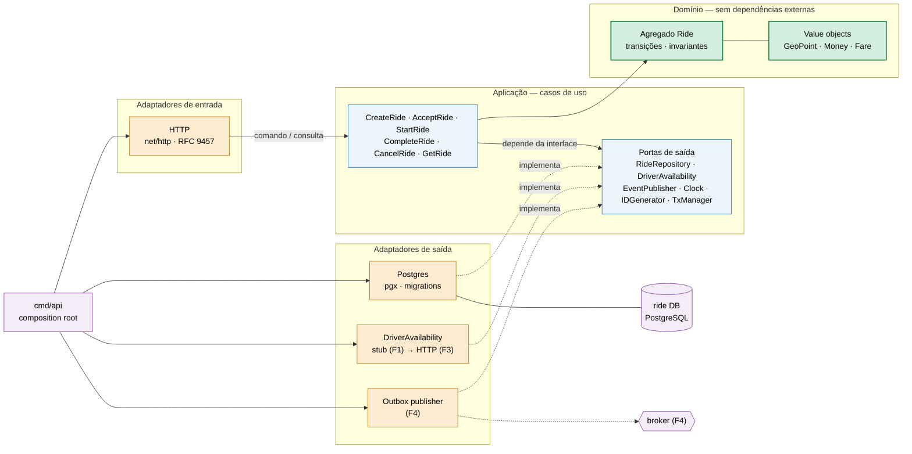

# ride-service

Serviço dono do **ciclo de vida da corrida**. Recebe os comandos de passageiro e
motorista, aplica a máquina de estados e persiste cada transição. É o orquestrador
do fluxo de corrida; os demais serviços reagem a eventos ou são consultados por
ele.

- Contrato público: [`contracts/ride-api.yaml`](contracts/ride-api.yaml)
- Visão de sistema: [`docs/diagrams/arquitetura.md`](../docs/diagrams/arquitetura.md)
- Regras de domínio: [`docs/domain.md`](../docs/domain.md)
- Desenho renderizado: [`docs/arquitetura.svg`](docs/arquitetura.svg)

## 1. Limites do serviço

**Faz:**

- cria a corrida (`REQUESTED`);
- aplica as transições `ACCEPTED`, `IN_PROGRESS`, `COMPLETED`, `CANCELLED`;
- garante as invariantes do agregado `Ride`;
- controla concorrência com `version` (optimistic locking);
- garante idempotência dos comandos;
- calcula a tarifa estimada e a final (até a Fase 7, quando isso vira serviço);
- publica eventos de domínio via Outbox (Fase 4).

**Não faz:**

- não conhece nome, telefone ou veículo do motorista — só pergunta se ele está
  disponível e guarda um snapshot no aceite;
- não faz matching nem cálculo geoespacial;
- não autentica (Fase 8);
- não processa pagamento;
- não acessa o banco de nenhum outro serviço.

## 2. Estilo arquitetural

**Hexagonal (ports & adapters) com domínio rico.** A dependência aponta sempre
para dentro:

```
adapters  →  app  →  domain
cmd/api   →  tudo (composition root)
domain    →  nada além da stdlib
```

Motivo prático: na Fase 1 a disponibilidade do motorista é um *stub* e na Fase 3
vira uma chamada HTTP. Com o domínio atrás de portas, **nenhuma regra de negócio
muda** quando o adaptador troca.



## 3. Estrutura de pastas (alvo)

```
ride-service/                       # este repositório
├── cmd/api/main.go                 # composition root: lê config e injeta adaptadores
├── internal/
│   ├── domain/ride/                # agregado, status, value objects, erros
│   │   ├── ride.go
│   │   ├── status.go               # máquina de estados
│   │   ├── fare.go
│   │   ├── money.go
│   │   ├── geopoint.go
│   │   ├── errors.go
│   │   └── ride_test.go            # tabela de transições
│   ├── app/                        # casos de uso + definição das portas
│   │   ├── ports.go
│   │   ├── create_ride.go
│   │   ├── accept_ride.go
│   │   ├── start_ride.go
│   │   ├── complete_ride.go
│   │   ├── cancel_ride.go
│   │   ├── get_ride.go
│   │   └── idempotency.go          # decorator dos comandos
│   ├── adapters/
│   │   ├── http/                   # handler, router, problem+json, middleware
│   │   ├── postgres/               # repositório, idempotência, transação
│   │   └── driverclient/           # stub (F1) e cliente HTTP com resiliência (F3)
│   └── platform/                   # config, clock, geração de IDs
│       ├── config/
│       ├── clock/
│       └── id/
├── migrations/                     # migrations SQL do schema ride
├── docs/arquitetura.svg
├── Dockerfile
├── go.mod
└── README.md
```